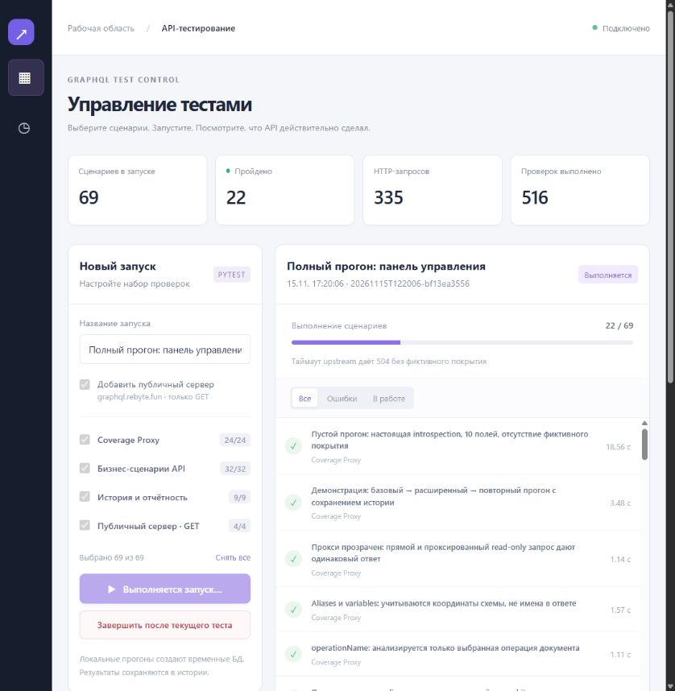
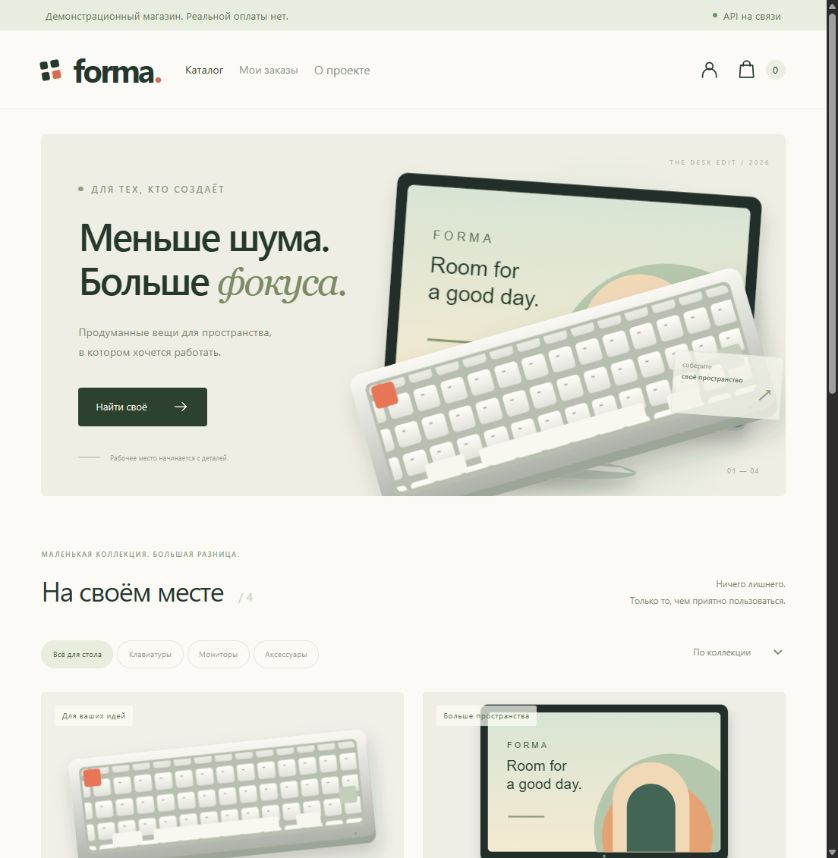

# GraphQL Coverage Proxy — QA

Самостоятельный QA-проект команды QualiMeter: проверки API и покрытия GraphQL, панель запуска тестов, история с HTTP-доказательствами и демонстрационный магазин **FORMA** с настоящей PostgreSQL.



## Репозитории команды

| Репозиторий | Ответственность |
| --- | --- |
| [Backend](https://github.com/QualiMeter/GraphQL-Coverage-Proxy-Beckend) | Coverage Proxy, анализ операций, хранение схем и покрытия, REST API |
| [Frontend](https://github.com/QualiMeter/GraphQL-Coverage-Proxy-Frontend) | Основной интерфейс продукта и визуализация покрытия |
| [QA](https://github.com/QualiMeter/GraphQL-Coverage-Proxy-QA) | Автотесты, временные стенды, отчёты, панель тестов и отдельный пример магазина |

QA запускает backend из его checkout, не редактируя исходники. Frontend не требуется для прогона. `demo_service` — самостоятельный бизнес-upstream с заказами; `mini_shop` — его витрина. Командный frontend ими не заменяется.

## Требования

- Git, Python 3.12+; локально проверено на Windows / Python 3.14.
- Docker Desktop с Linux engine или Docker Engine с Compose v2.
- Chromium для Playwright. На Windows автоматически используется установленный Microsoft Edge; браузер запускается с отдельным временным профилем.
- Свободные порты 9020 и 9110 нужны только для панели и ручной демонстрации. Автотесты выбирают случайные порты.

## Установка и первый запуск

Пока проект находится в feature-ветке, клонируйте её явно. После объединения в `main` параметр `--branch` можно убрать.

```sh
git clone https://github.com/QualiMeter/GraphQL-Coverage-Proxy-Beckend.git
git clone --branch feat/qa-platform-and-demo-shop https://github.com/QualiMeter/GraphQL-Coverage-Proxy-QA.git
cd GraphQL-Coverage-Proxy-QA
python -m venv .venv
```

Windows / PowerShell:

```powershell
.\.venv\Scripts\python -m pip install -r requirements.lock.txt
$env:PLAYWRIGHT_BROWSERS_PATH = "$PWD/.browsers"
.\.venv\Scripts\python -m playwright install chromium
.\.venv\Scripts\python run_tests.py --suite all --local
```

Linux / macOS:

```sh
.venv/bin/python -m pip install -r requirements.lock.txt
PLAYWRIGHT_BROWSERS_PATH="$PWD/.browsers" .venv/bin/python -m playwright install --with-deps chromium
.venv/bin/python run_tests.py --suite all --local
```

Docker должен быть запущен. Полный прогон создаёт изолированные PostgreSQL, исполняет миграции backend, запускает процессы API и браузер, сохраняет доказательства и удаляет только своё окружение. Рабочая БД команды и постоянная БД демо-магазина не используются. Подробнее: [установка и диагностика](docs/INSTALLATION.md).

Backend автоматически находится в соседней папке `GraphQL-Coverage-Proxy-Beckend` или `coverage-backend`. Другой путь задаётся параметром `--coverage-backend-dir /path/to/backend` либо переменной `COVERAGE_BACKEND_DIR`. Для панели используйте переменную окружения до запуска процесса.

## Панель управления

```powershell
.\.venv\Scripts\python control_panel.py
```

На Linux/macOS используйте `.venv/bin/python`. Откройте **http://localhost:9020/**: выберите сценарии, задайте название и запустите. Видны фактические HTTP-запросы, ответы, проверки ожидания/факта, поля схемы и история. «Обновить список» подхватывает новые pytest-сценарии.

Отмена дожидается текущего теста и очистки окружения, затем останавливает запуск перед следующим сценарием. Длительный запрос может занимать до своего таймаута. Отмена сохраняется отдельным статусом.

## Мини-магазин FORMA

```sh
docker compose -p gql-commerce-demo -f compose.demo.yaml up --build -d --wait
```

- Магазин: **http://localhost:9110/**.
- GraphQL бизнес-API: `POST http://localhost:9100/graphql`.
- Демо-аккаунты: `alice@example.test`, `bob@example.test`, `admin@example.test`; пароль `test-password-2026`.
- Каталог → корзина → вход → заказ → история → отмена. Суммы и остатки сохраняются в БД; реальных платежей нет.
- API-инспектор показывает операции, переменные, ответы и время; пароли и токены скрываются.



Обычный магазин подключён напрямую к своему API. В браузерных автотестах маршрут проходит через Coverage Proxy с отдельным run ID, поэтому пользовательские действия попадают в фактическое покрытие.

Остановка с сохранением данных: `docker compose -p gql-commerce-demo -f compose.demo.yaml down`.
[Сценарий демонстрации и разработка витрины](mini_shop/README.md) · [Контракт бизнес-API](demo_service/README.md).

## Выбор тестов

Команды ниже показаны для PowerShell; на Linux/macOS замените путь к Python на `.venv/bin/python`.

```powershell
.\.venv\Scripts\python run_tests.py --suite coverage --local
.\.venv\Scripts\python run_tests.py --suite business --local
.\.venv\Scripts\python run_tests.py --suite tooling
.\.venv\Scripts\python run_tests.py --suite business --local -- -k storefront
.\.venv\Scripts\python run_tests.py --suite all --local -- -k cancelled_order_filter
```

`all` включает proxy/coverage, бизнес-API, браузерные сценарии и проверки отчётности/установки. Каталог определяется pytest; число сценариев отображается в панели. Набор `live` включается явно и выполняет только GET-запросы; недоступность указанного сервера считается ошибкой:

```powershell
.\.venv\Scripts\python run_tests.py --suite live --live-base-url https://graphql.rebyte.fun
```

Исторический набор `shop` и `prove_detection.py` требуют старого `graphql-example/backend`; это необязательные материалы, в `all` не входят. `verify_sources.py` и `source-baseline.json` относятся к исходному локальному снимку командных файлов и не являются CI-проверкой актуального backend main.

## Результаты

Каждый запуск сохраняется в `reports/runs/<UTC-время-UUID>/`. Старые результаты не перезаписываются. Папка исключена из Git. Внутри: HTML, `results.json`, `manifest.json`, `field-usage.json`, `junit.xml`, журналы инфраструктуры, скриншоты и Playwright trace. `progress.json` и `live/` питают панель во время выполнения.

Панель показывает всю историю. Для отдельного просмотра: `python serve_reports.py` → **http://localhost:9010/**. Файлы `reports/index.html` и `reports/latest/index.html` также можно открыть вручную.

Покрытие берётся из Coverage API. Ожидания тестов не выдаются за измеренные поля. Повторные обращения одной операции показываются агрегированно, поскольку сервер не отдаёт координаты каждого запроса. Ограничения и матрица требований: [TEST_PLAN.md](TEST_PLAN.md).

## CI и совместная работа

[GitHub Actions](.github/workflows/tests.yml) запускается при push, pull request и вручную. CI получает отдельный checkout backend, устанавливает зависимости и Chromium, запускает `all`, загружает отчёты. При ручном запуске можно выбрать backend ref. Для публичного backend дополнительные credentials не нужны; для приватного предусмотрен секрет `COVERAGE_BACKEND_TOKEN` с правом чтения.

[Устройство проекта](docs/ARCHITECTURE.md) · [Порядок работы команды](CONTRIBUTING.md) · [Как писать тесты](WRITING_TESTS.md).

Для воспроизводимого прогона фиксируйте backend commit/ref и используйте `requirements.lock.txt`. GitHub Actions проверяет Linux/Python 3.12; локальный результат не объявляется результатом CI.
