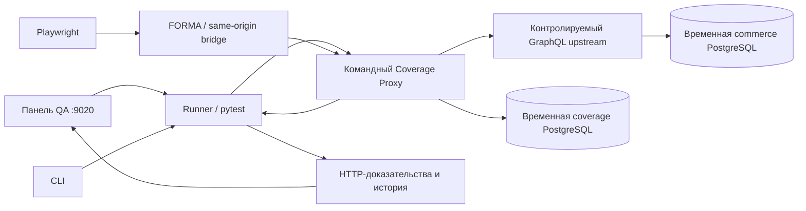

# Архитектура и границы

Для проверок самого proxy используется компактная `fixtures/schema.graphql` с контролируемыми сбоями. Для бизнес-сценариев используется `demo_service` с PostgreSQL, сессиями, заказами нескольких товаров, транзакциями, остатками и idempotency key. Наборы выполняются последовательно, xdist не поддерживается.

`environment.py` создаёт уникальный Compose project и случайные порты, запускает миграции и дочерние HTTP-процессы. Временная БД хранится в tmpfs. `conftest.py` собирает HTTP-события и проверки; `coverage_client.py` получает измерения backend; `business_client.py` управляет тестовыми пользователями и очисткой созданных заказов.

`history.py`, `progress.py`, `report.py` сохраняют историю, live-состояние и HTML. Панель `control_panel.py` принимает только известные pytest IDs, защищает команды локальным токеном, слушает loopback и запускает один прогон одновременно. Отмена мягкая: следующий тест не начинается, teardown текущего завершает очистку.

`mini_shop/server.py` — BFF витрины: цель задана серверным окружением. При автотестах серверный ключ покрытия и run ID остаются на BFF. Обычный Compose-магазин идёт напрямую в commerce API и хранит свои данные отдельно от тестов.

Основной frontend команды интегрируется с backend в своём репозитории. Для объединения продукта не требуется копировать QA-код в backend или frontend: QA получает checkout конкретного backend ref. Последующие проверки командного UI можно добавить отдельным набором, не изменяя текущую панель тестов.

## Достоверность отчёта

- Ожидаемые поля задаются независимо от анализатора.
- Реальные `hits` читаются из `/coverage` и `/operations`.
- Статус анализа не означает успешность каждого резолвера.
- Поля повторяющейся операции доступны агрегированно; отчёт обозначает этот scope.
- Тестовые БД удаляются, но доказательства и карта полей остаются в уникальной папке запуска.
- Пароли, tokens и чувствительные заголовки маскируются в журнале API. Playwright trace и диагностические файлы предназначены для тестовых данных, поэтому не коммитьте runtime-артефакты.
