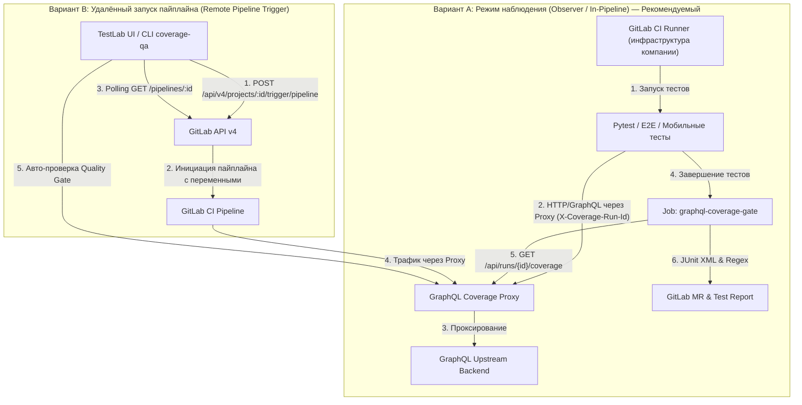

# Интеграция GraphQL Coverage Proxy с GitLab CI/CD

Настоящий документ описывает архитектуру и практическое руководство по подключению **GraphQL Coverage Proxy** и платформы тестирования **TestLab** к корпоративным конвейерам **GitLab CI/CD**.

---

## Архитектурные модели

В соответствии с требованиями корпоративной безопасности и спецификой инфраструктуры заказчика поддерживаются два режима интеграции:



---

## Вариант А: Режим наблюдения (Observer Mode)

### Принцип работы
- Компания запускает тесты в своём GitLab CI.
- Исходный код тестов, секреты и внутренняя инфраструктура остаются внутри контура заказчика.
- Единственное требование: направить GraphQL-трафик через адрес Coverage Proxy с передачей идентификатора прогона.

### Пример `.gitlab-ci.yml`
```yaml
stages:
  - test
  - quality-gate

variables:
  COVERAGE_URL: "http://coverage-proxy.internal:8000"
  COVERAGE_MIN_PERCENT: "80.0"

# Этап 1: Выполнение существующих автотестов через Coverage Proxy
run-api-tests:
  stage: test
  image: python:3.12-slim
  script:
    - pip install -r requirements.txt
    - |
      # Запуск ваших тестов с проксированием GraphQL-запросов
      pytest -v --junitxml=reports/tests.xml
  artifacts:
    when: always
    reports:
      junit: reports/tests.xml

# Этап 2: Quality Gate по покрытию GraphQL-схемы
graphql-coverage-gate:
  stage: quality-gate
  image: python:3.12-slim
  before_script:
    - pip install graphql-coverage-qa
  script:
    - |
      RUN_ID="${COVERAGE_RUN_ID:-$CI_PIPELINE_IID}"
      coverage-qa gitlab gate \
        --coverage-url "$COVERAGE_URL" \
        --api-key "$COVERAGE_API_KEY" \
        --run-id "$RUN_ID" \
        --min-coverage "$COVERAGE_MIN_PERCENT" \
        --junit-out reports/coverage-junit.xml \
        --csv-out reports/coverage-fields.csv \
        --summary-out reports/coverage-summary.json
  # Нативный сбор процента покрытия в GitLab CI:
  coverage: '/Total coverage:\s*([0-9.]+)%/'
  artifacts:
    when: always
    reports:
      junit: reports/coverage-junit.xml
    paths:
      - reports/coverage-junit.xml
      - reports/coverage-fields.csv
      - reports/coverage-summary.json
```

### Как GitLab отображает результаты:
1. **Бейджи и MR Widget**: благодаря строке `Total coverage: XX.XX%` и директиве `coverage: '/Total coverage:\s*([0-9.]+)%/'`, GitLab вычисляет и выводит точный процент покрытия прямо в интерфейсе Merge Request и бейджах репозитория.
2. **Вкладка Test Summary в GitLab**: сгенерированный `reports/coverage-junit.xml` содержит проверки `test_field_coverage_threshold` и `test_schema_completeness`. Если покрытие ниже нормы, шаг падает с детальным перечнем непокрытых полей схемы прямо в интерфейсе GitLab.

---

## Вариант В: Удалённый запуск пайплайна (Remote Pipeline Trigger)

### Принцип работы
- Инженер по тестированию нажимает кнопку в панели **TestLab** (вкладка `🦊 GitLab CI`) или выполняет CLI-команду.
- Система формирует запрос к официальному GitLab API v4 (`/api/v4/projects/:id/trigger/pipeline` или `/api/v4/projects/:id/pipeline`).
- Пайплайн запускается на раннерах компании с переданными переменными `COVERAGE_RUN_ID` и `COVERAGE_PROXY_URL`.
- TestLab отслеживает выполнение (`pending` -> `running` -> `success`), выводит ссылку на пайплайн в GitLab и при успешном завершении автоматически опрашивает Coverage Proxy и отображает финальный процент покрытия.

### Запуск через CLI
```bash
coverage-qa gitlab trigger \
  --host https://gitlab.company.ru \
  --project 12345 \
  --token "$GITLAB_TRIGGER_TOKEN" \
  --ref main \
  --run-id "run-forma-ci-42" \
  --coverage-url "http://coverage-proxy.internal:8000" \
  --min-coverage 80.0 \
  --wait
```

### Параметры CLI `coverage-qa gitlab trigger`
- `--project`: Числовой ID проекта или URL-encoded путь (например, `org/repo`).
- `--token`: Токен триггера (Pipeline Trigger Token) или Personal Access Token (`glpat-...`).
- `--ref`: Ветка или тег (по умолчанию `main`).
- `--host`: Базовый URL инстанса GitLab (по умолчанию `https://gitlab.com`).
- `--run-id`: Идентификатор прогона в Coverage Proxy.
- `--coverage-url`: URL сервиса покрытия.
- `--wait`: Ожидать завершения пайплайна в реальном времени.
- `--timeout`: Таймаут ожидания в секундах (по умолчанию 600с).
- `--poll-interval`: Интервал опроса статуса (по умолчанию 5с).

---

## Проверка Quality Gate вручную (CLI)

```bash
coverage-qa gitlab gate \
  --coverage-url "http://localhost:8000" \
  --api-key "$COVERAGE_API_KEY" \
  --run-id "xxxx-xxxx-xxxx-xxxx" \
  --min-coverage 80.0 \
  --junit-out reports/junit.xml \
  --csv-out reports/coverage.csv \
  --summary-out reports/summary.json
```

Вывод команды:
```text
============================================================
GraphQL Coverage Quality Gate: RUN 11111111-1111-1111-1111-111111111111
Total coverage: 90.00%
Covered fields: 9 / 10
Threshold: 80.00%
Status: PASSED
Uncovered (1):
  - Product.sku
============================================================
JUnit XML generated: reports/junit.xml
CSV report generated: reports/coverage.csv
Summary JSON generated: reports/summary.json
```

Код возврата:
- `0` — Покрытие `>= min_coverage` (успех).
- `1` — Покрытие `< min_coverage` или ошибка выполнения.

---

## Генерация шаблона `.gitlab-ci.yml`

Вы можете в любой момент сгенерировать готовый шаблон конфигурации командой:
```bash
coverage-qa gitlab template --out .gitlab-ci.yml
```
